# Post-contenido 1 — Unidad 5: Emuladores y Virtualización

**Arquitectura de Computadores · Unidad 5 · Post-contenido**

| Dato | Valor |
|---|---|
| Estudiante | Juan Camilo Durán Bohórquez |
| Código | 1152532 |
| Repositorio | [duran-post1-u5](https://github.com/juancamilodb6714/duran-post1-u5) |

## Contenido

1. [Descripción del laboratorio](#descripción-del-laboratorio)
2. [Estructura del repositorio](#estructura-del-repositorio)
3. [Cómo reproducir el laboratorio](#cómo-reproducir-el-laboratorio)
4. [Parte 1: DOSBox](#parte-1-dosbox)
5. [Parte 2: VirtualBox](#parte-2-virtualbox)
6. [Mapa de evidencias](#mapa-de-evidencias)
7. [Conclusiones](#conclusiones)
8. [Referencias](#referencias)

## Descripción del laboratorio

El laboratorio tiene dos partes en un mismo repositorio. En la Parte 1 el estudiante trabajó con DOSBox-X, un emulador que recrea por software el hardware x86 de 16 bits y el entorno DOS, ahí escribió, ensambló con NASM y ejecutó los programas saludo.asm, entrada.asm y ciclos.asm, y revisó su comportamiento con DEBUG. En la Parte 2 trabajó con VirtualBox, un virtualizador que le presta hardware casi real a un sistema operativo huésped completo, ahí creó la VM Lab5-Alpine con Alpine Linux, configuró los modos de red, manejó snapshots, reasignó CPU y RAM, comparó un disco dinámico con uno fijo y exportó la VM en formato OVF.

Cada parte tiene ocho checkpoints y dos decisiones técnicas justificadas, cuatro en total.

| Decisión técnica | Parte | Ubicación |
|---|---|---|
| Valor de cycles correcto para el laboratorio | 1 | Parte 1, Paso 8 |
| Tiempo emulado frente a ciclos de CPU real | 1 | Parte 1, Paso 9 |
| Modo de red y sus implicaciones de seguridad | 2 | Parte 2, Paso 7 |
| Disco fijo frente a dinámico y asignación de CPU/RAM | 2 | Parte 2, Paso 8 |

## Estructura del repositorio

```
duran-post1-u5/
├── README.md                  documentación de ambas partes
├── dosbox.conf                configuración de DOSBox-X (Parte 1)
├── src/                       saludo.asm, entrada.asm, ciclos.asm (Parte 1)
├── bin/                       saludo.com, entrada.com, ciclos.com (Parte 1)
├── VBoxManage_commands.sh     comandos de VirtualBox (Parte 2)
└── capturas/                  evidencia de los checkpoints
     ├── Parte 1: cp2_dosbox_nasm, cp3_saludo, cp4_entrada, cp5_debug,
     │            cp6_ciclos, cp7_cycles_8000, cp7_cycles_1000, cp7_cycles_20000, cp8_cycles_decisiones
     └── Parte 2: cp1_vm_config, cp2_alpine_instalado, cp3_red_nat, cp3_red_hostonly,
                  cp3_red_hostonly virtualBox, cp3_red_bridge, cp4_snapshots, cp4_restauracion,
                  cp5_recursos, cp6_disco, cp7_decisiones_red_disco, cp8_recursos_disco
```

| Archivo | Parte | Para qué se usó |
|---|---|---|
| [dosbox.conf](dosbox.conf) | 1 | Fija `cycles=8000` y monta la carpeta del proyecto como unidad C |
| [src/saludo.asm](src/saludo.asm) y [bin/saludo.com](bin/saludo.com) | 1 | Salida de texto con INT 21h función 09h, Pasos 3 y 5 |
| [src/entrada.asm](src/entrada.asm) y [bin/entrada.com](bin/entrada.com) | 1 | Lectura de teclado y eco en hexadecimal, Paso 4 |
| [src/ciclos.asm](src/ciclos.asm) y [bin/ciclos.com](bin/ciclos.com) | 1 | Medición de tiempo con INT 21h función 2Ch, Pasos 6 y 7 |
| [VBoxManage_commands.sh](VBoxManage_commands.sh) | 2 | Comandos de creación, red, snapshots, recursos, discos y exportación de la VM |
| [capturas/](capturas/) | 1 y 2 | Evidencia de cada checkpoint, ver el [mapa de evidencias](#mapa-de-evidencias) |

## Cómo reproducir el laboratorio

Para la Parte 1 se ajusta la ruta de la línea `mount c` de dosbox.conf a la carpeta local del proyecto, se copia nasm.exe para DOS en la raíz y se inicia el emulador con `dosbox-x.exe -conf dosbox.conf`. Cada programa se ensambla desde `C:\src` y se ejecuta desde la raíz.

```
C:\> cd src
C:\src> nasm -f bin saludo.asm -o ..\bin\saludo.com
C:\src> nasm -f bin entrada.asm -o ..\bin\entrada.com
C:\src> nasm -f bin ciclos.asm -o ..\bin\ciclos.com
C:\src> cd ..
C:\> bin\saludo
C:\> bin\entrada
C:\> bin\ciclos
```

Para la Parte 2 se siguen en orden los comandos de VBoxManage_commands.sh con VirtualBox 7.x y el ISO alpine-standard-3.19.0-x86_64.iso. Los comandos que van dentro de la VM aparecen ahí como comentarios.

---

## Parte 1: DOSBox

Entorno de desarrollo en ensamblador x86 de 16 bits. Los fuentes están en [src/](src/), los ejecutables en [bin/](bin/) y la configuración del emulador en [dosbox.conf](dosbox.conf).

### Entorno de trabajo

| Elemento | Valor |
|---|---|
| Emulador | DOSBox-X 2026.08.31 |
| Ensamblador | NASM 2.16.03 para DOS |
| Configuración | dosbox.conf con `core=normal`, `cputype=auto`, `cycles=8000`, `memsize=16`, `scaler=normal2x` |
| Sistema anfitrión | Windows |

### Paso 1: Preparación del directorio de trabajo

Se creó la carpeta duran-post1-u5 con las subcarpetas src, bin y capturas, y se inicializó el repositorio con `git init` y `git checkout -b main`.

### Paso 2: Configuración de DOSBox

Se creó dosbox.conf en la raíz del proyecto y se inició con `C:\DOSBox-X\dosbox-x.exe -conf dosbox.conf`. El autoexec monta la carpeta del proyecto como unidad C y deja el prompt `C:\>` listo. Se copió nasm.exe en la raíz y con `nasm -v` se vio la versión del ensamblador. El ejecutable nasm.exe no se versiona en el repositorio.

**Checkpoint 2**

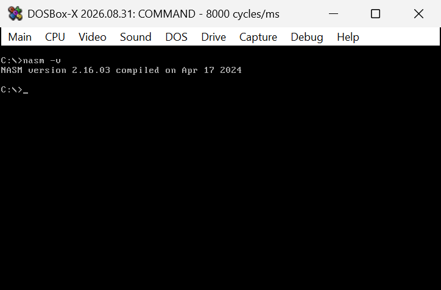

### Paso 3: Primer programa — salida de texto con INT 21h

[src/saludo.asm](src/saludo.asm) usa la interrupción 21h con la función 09h, que imprime una cadena hasta el carácter `$`, y termina con la función 4Ch.

```
C:\> cd src
C:\src> nasm -f bin saludo.asm -o ..\bin\saludo.com
C:\src> cd ..
C:\> bin\saludo
```

**Checkpoint 3**

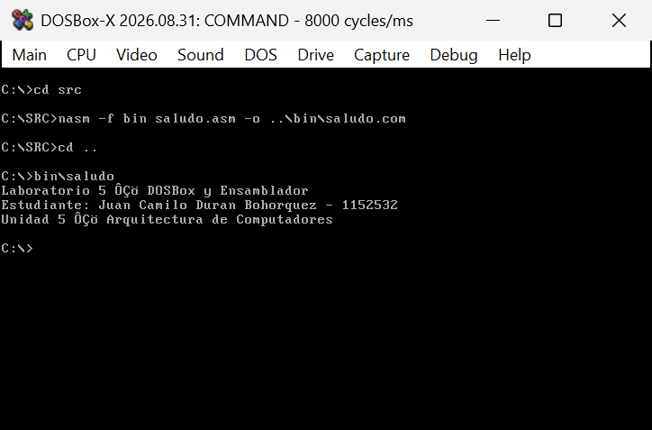

### Paso 4: Segundo programa — entrada de teclado y eco

[src/entrada.asm](src/entrada.asm) lee una tecla con la función 07h sin eco, la muestra con la función 02h y luego imprime su código ASCII en hexadecimal separando el nibble alto con `shr al, 4` y el nibble bajo con `and al, 0Fh`.

```
C:\> cd src
C:\src> nasm -f bin entrada.asm -o ..\bin\entrada.com
C:\src> cd ..
C:\> bin\entrada
```

Con la letra J el programa mostró el código 4A, que es 74 en decimal y corresponde a la J en la tabla ASCII.

**Checkpoint 4**

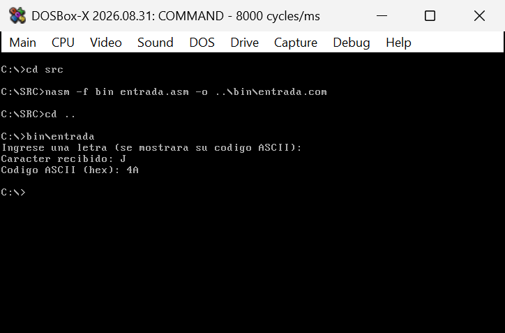

### Paso 5: Verificación con DEBUG

Se cargó saludo.com con `debug bin\saludo.com` y se usaron los comandos `r`, `u`, `t`, `g` y `q`.

| Paso | Instrucción | AX | DX |
|---|---|---|---|
| Estado inicial con `r` | | `0000` | `0000` |
| `t` | `MOV AH,09` | `0900` | `0000` |
| `t` | `MOV DX,010C` | `0900` | `010C` |
| `t` | `INT 21` | `0924` | `010C` |
| `g` | resto del programa | el programa imprime el mensaje y termina | |

Con `u` se vio el desensamblado desde la dirección 100h, primero `MOV AH,09`, luego `MOV DX` con la dirección de la cadena, `INT 21`, `MOV AX,4C00` y otra vez `INT 21`.

**Checkpoint 5**

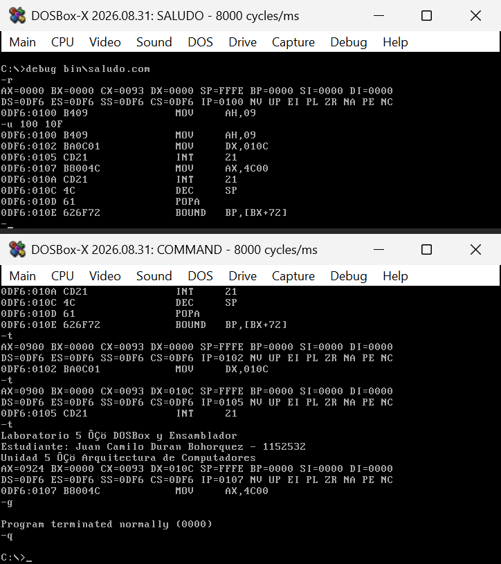

### Paso 6: Programa 3 — medición de tiempo real con INT 21h función 2Ch

[src/ciclos.asm](src/ciclos.asm) lee la hora del sistema con la función 2Ch antes y después de un bucle fijo de 2000 por 65535 iteraciones de `inc ax` con `loop`, y luego imprime las dos marcas con la subrutina print_dec2, que usa `aam` para separar decenas y unidades.

```
C:\> cd src
C:\src> nasm -f bin ciclos.asm -o ..\bin\ciclos.com
C:\src> cd ..
C:\> bin\ciclos
```

Con cycles=8000 la hora inicial fue `11:11:35:85` y la final `11:12:08:70`, la diferencia es mayor que cero.

**Checkpoint 6**

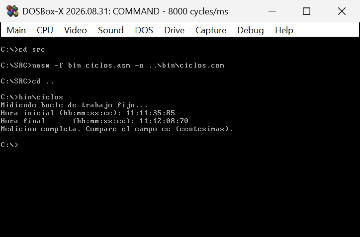

### Paso 7: Comparación del efecto de cycles en dosbox.conf

Se cambió solo la línea cycles en dosbox.conf y se reinició DOSBox-X antes de cada corrida. Como el bucle dura más de un segundo, la duración se calculó con la diferencia de la hora completa pasada a centésimas.

| Corrida | Cycles | Hora inicial (cc) | Hora final (cc) | Duración observada (centésimas) |
|---|---|---|---|---|
| 1 | 8000 | `11:11:35:85` | `11:12:08:70` | 3285 |
| 2 | 1000 | `11:13:38:00` | `11:18:08:13` | 27013 |
| 3 | 20000 | `11:18:55:97` | `11:19:09:10` | 1313 |

La corrida con cycles=1000 fue la más lenta y la de cycles=20000 la más rápida, y en las tres el programa terminó bien, entonces cycles controla la velocidad de emulación y no la corrección del programa. Las duraciones salieron casi proporcionales al valor de cycles.

**Checkpoint 7**


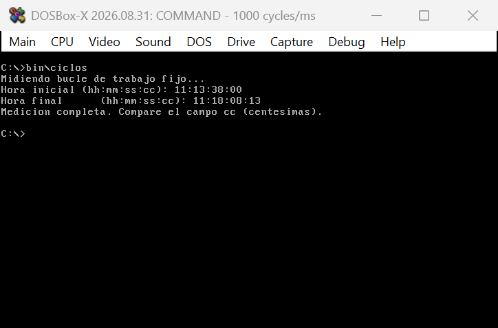
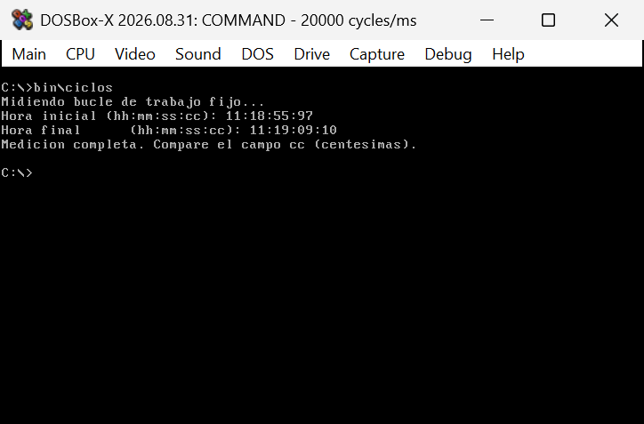

### Paso 8: Decisión Técnica — ¿qué valor de cycles es el correcto para este laboratorio?

Con cycles=max DOSBox-X ejecuta todas las instrucciones que el procesador anfitrión le permita, y un equipo moderno puede emular cientos de miles de instrucciones por milisegundo, entonces ciclos.com terminaría casi de inmediato sin importar el número de iteraciones fijado en el código fuente. Eso invalida la medición porque el programa está hecho para ver cuánto tarda un trabajo fijo a una velocidad conocida, y con max la velocidad depende del procesador de cada estudiante y de lo que tenga abierto, así que la emulación queda desacoplada del hardware histórico de referencia. Con cycles=auto pasa algo parecido porque DOSBox-X va ajustando el valor según lo que parezca necesitar el programa. Por eso el valor correcto para este laboratorio es el fijo cycles=8000, ya que todos los equipos emulan la misma cantidad de instrucciones por milisegundo y los resultados de distintos estudiantes se pueden comparar, lo que hace el laboratorio reproducible. Fuera del laboratorio cycles=max o cycles=auto sí son la opción correcta, por ejemplo para software de productividad reescrito para DOS o compiladores que no dependen del reloj del procesador, donde lo único que importa es que corran lo más rápido posible.

### Paso 9: Decisión Técnica — tiempo emulado en DOSBox frente a una estimación de ciclos de CPU real

Comparar directamente cycles=8000 con la frecuencia del procesador anfitrión sería un error de categoría, porque cycles mide instrucciones x86 emuladas por unidad de tiempo virtual, más o menos por milisegundo, mientras que los GHz miden ciclos de reloj físicos del silicio real, miles de millones por segundo. Cada instrucción de 16 bits que DOSBox-X emula la tiene que interpretar por software, decodificar el opcode, actualizar los registros emulados, calcular flags y además atender el temporizador y el video emulados, y eso le cuesta un número variable de instrucciones nativas del anfitrión. Esto implica que el anfitrión ejecuta muchos más ciclos reales de los que sugiere cycles, y que subir cycles se refleja en un mayor uso de CPU del proceso dosbox-x.exe en el sistema operativo anfitrión, no en una relación directa con la frecuencia del procesador. Para estimar con precisión cuántos ciclos reales consume ciclos.com dentro de DOSBox-X no sirve leer el archivo de configuración, lo apropiado es medir el proceso desde el anfitrión con un perfilador como Process Explorer, que muestra los ciclos de CPU por proceso, o con el Administrador de tareas y el Monitor de rendimiento de Windows, o con perf stat en Linux.

**Checkpoint 8**

La captura muestra las dos decisiones técnicas de los Pasos 8 y 9 tal como quedaron en este README, junto con la tabla del Paso 7 ya completa.

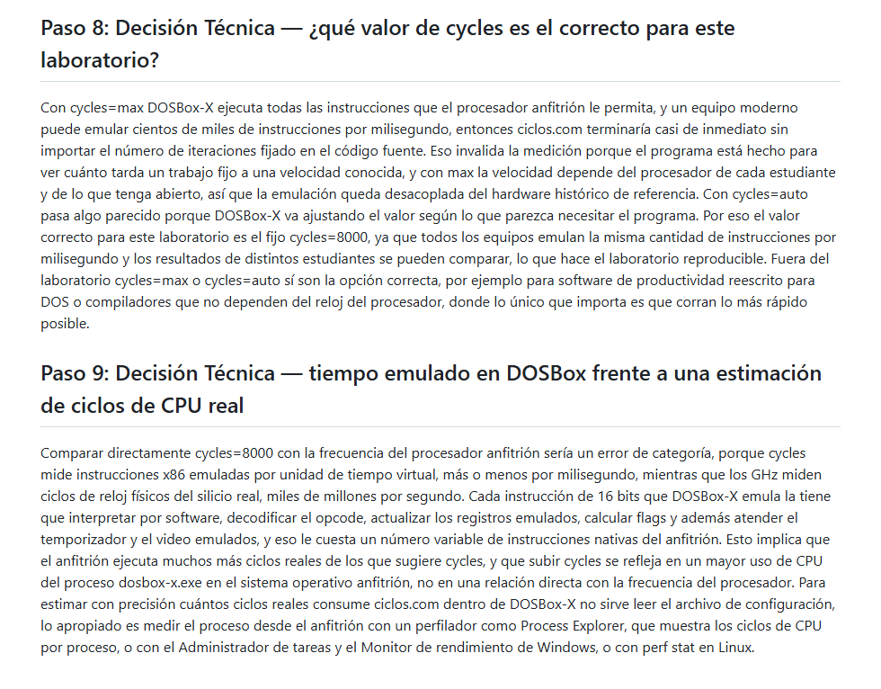

---

## Parte 2: VirtualBox

Creación y gestión de la máquina virtual Lab5-Alpine. Continúa en el mismo repositorio de la Parte 1 y sus capturas comparten la carpeta [capturas/](capturas/).

### Entorno de la VM

| Elemento | Valor |
|---|---|
| Virtualizador | Oracle VirtualBox 7.2.22 |
| Nombre de la VM | Lab5-Alpine |
| Sistema operativo | Alpine Linux 3.19 Standard, Other Linux 64-bit |
| RAM | 1024 MB, luego 2048 MB |
| CPU | 1, luego 2 |
| Disco | Lab5-Alpine.vdi dinámico de 10 GB y Lab5-Alpine-fixed.vdi fijo de 4 GB |
| Red inicial | NAT |

Todos los comandos usados, incluidos `modifyvm` y `createmedium`, están en [VBoxManage_commands.sh](VBoxManage_commands.sh), ordenados por paso.

### Paso 1: Creación de la máquina virtual

Se creó la VM con `VBoxManage createvm`, se le asignaron 1024 MB de RAM, 1 CPU y red NAT con `modifyvm`, se creó el disco con `createmedium` y se conectaron el disco y el ISO de Alpine con `storagectl` y `storageattach`.

**Checkpoint 1**

La captura se tomó al final del laboratorio, por eso ya sale con 2048 MB, 2 CPUs y el disco fijo conectado, que son los cambios de los pasos 5 y 6.

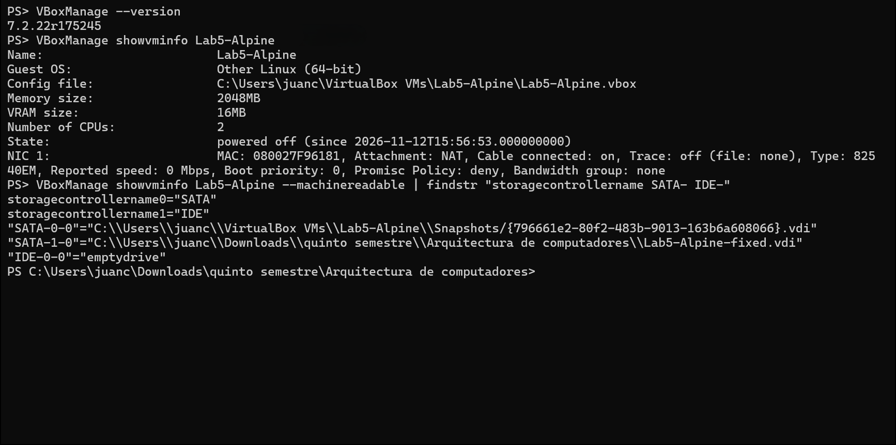

### Paso 2: Instalación del sistema operativo

Se arrancó desde el ISO y se ejecutó `setup-alpine` con teclado us, hostname lab5-vm, eth0 por dhcp, DNS 8.8.8.8, zona America/Bogota, chrony, openssh y el disco sda en modo sys. Después se apagó la VM, se retiró el ISO y arrancó desde el disco. `ip addr show eth0` mostró la IP `10.0.2.15` y `ping -c 3 8.8.8.8` respondió.

**Checkpoint 2**

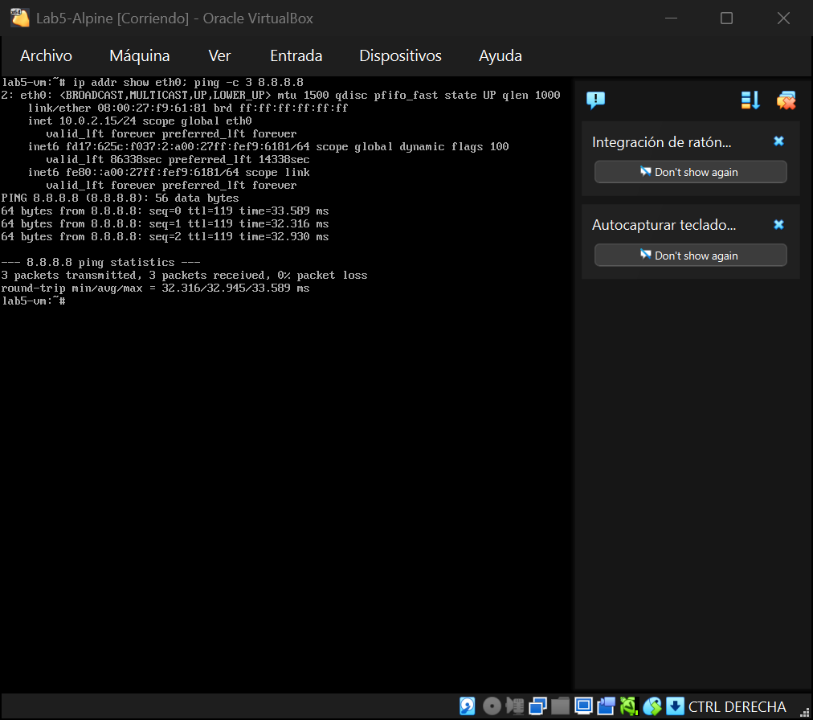

### Paso 3: Configuración de modos de red

| Modo | IP obtenida en eth0 | ping 8.8.8.8 desde la VM | ping desde el anfitrión a la VM |
|---|---|---|---|
| NAT | `10.0.2.15` | responde | no aplica |
| Host-Only | `192.168.56.101` | no responde | responde |
| Bridge | `192.168.1.93` | responde | responde |

En NAT la VM salió a internet por medio del anfitrión. En Host-Only quedó en una red aislada con el anfitrión en el rango 192.168.56.x, sin internet. En Bridge recibió una IP del router de la red local como cualquier otro equipo. El modo Host-Only se documenta con dos capturas, la primera tomada dentro de la VM y la segunda con el ping desde el anfitrión.

**Checkpoint 3**

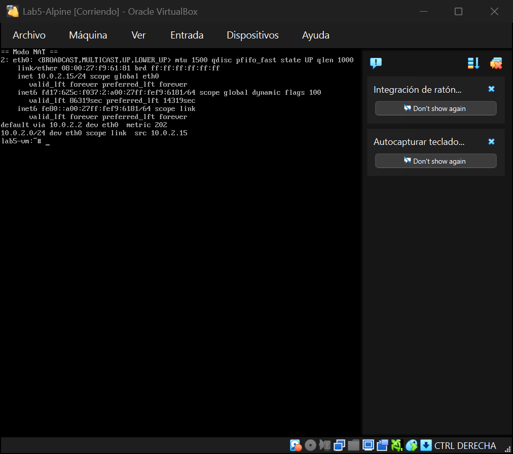

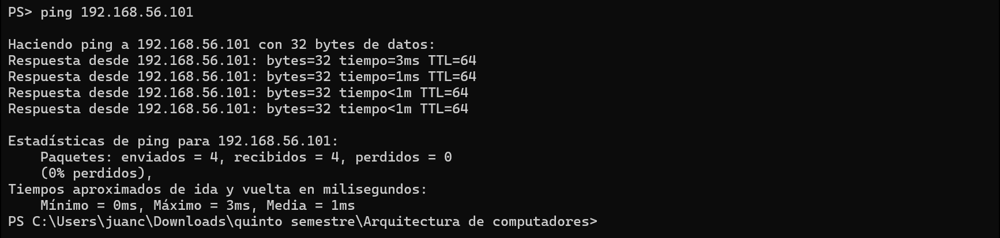
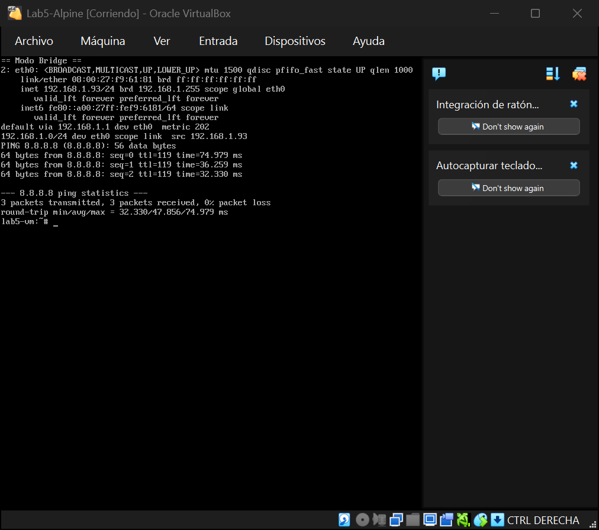

### Paso 4: Gestión de snapshots

Se tomó snap_base con Alpine recién instalado, luego se instalaron curl, wget, nano y htop con apk y se tomó snap_con_herramientas. Árbol mostrado por `VBoxManage snapshot "Lab5-Alpine" list`

```
   Name: snap_base (UUID: 49dd2022-11aa-4b33-abd9-7e0873cb183d)
   Description: Alpine Linux 3.19 recién instalado, sin modificaciones
      Name: snap_con_herramientas (UUID: 8212f1c4-f0d2-4346-b31f-c4b20056400d) *
      Description: Alpine con curl, wget, nano y htop instalados
```

Al restaurar snap_base y arrancar, `apk info curl` no devolvió nada, o sea que el software instalado ya no estaba.

**Checkpoint 4**

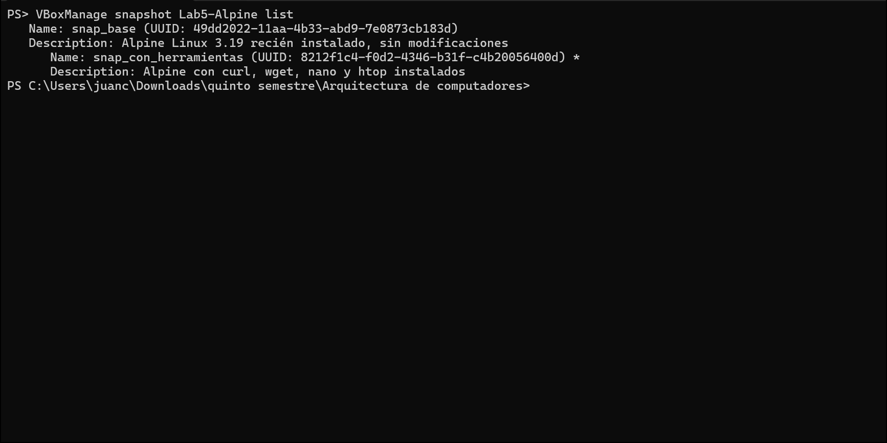
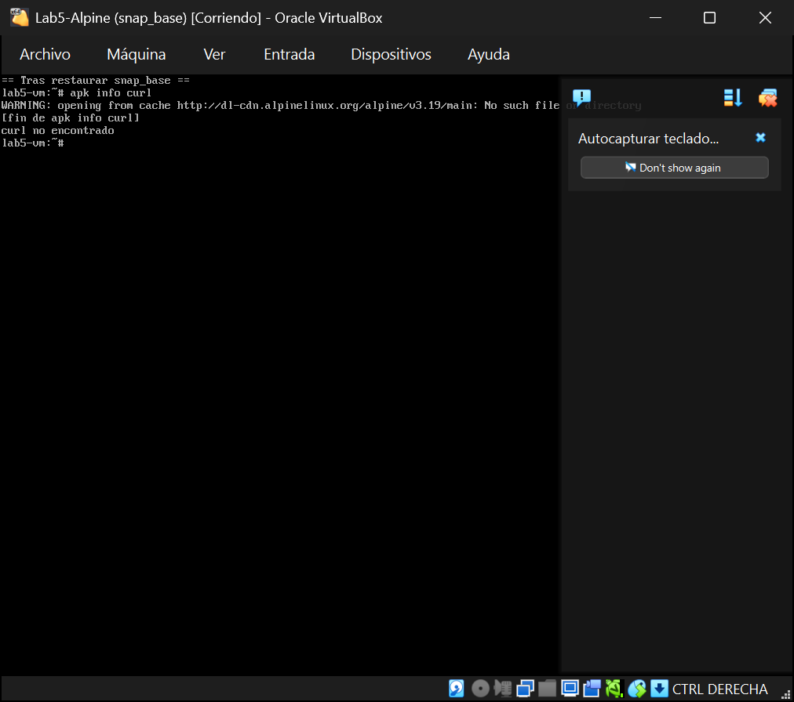

### Paso 5: Asignación de recursos con VBoxManage modifyvm

Con la VM apagada se ejecutó `VBoxManage modifyvm "Lab5-Alpine" --cpus 2 --memory 2048`. Al arrancar, `nproc` mostró 2 y `free -m` mostró un total de 1976 MB, cercano a los 2048 MB asignados.

**Checkpoint 5**

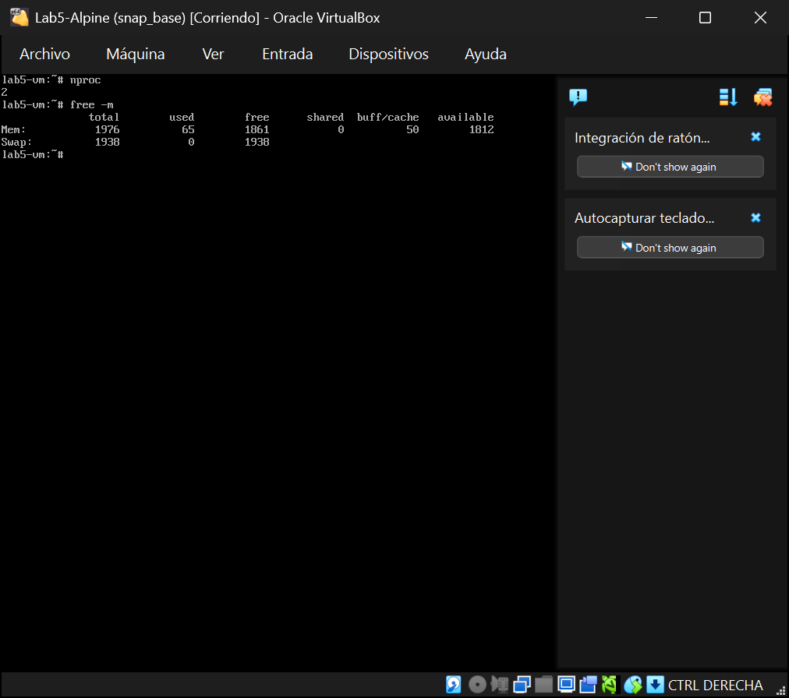

### Paso 6: Comparación de rendimiento entre disco dinámico y disco de tamaño fijo

Se creó Lab5-Alpine-fixed.vdi de 4 GB con `--variant Fixed`, se conectó en el puerto 1 del SATA, se particionó con fdisk, se formateó con mkfs.ext4 y se montó en /mnt/fijo. Luego se escribieron 200 MB con dd en cada disco.

| Tipo de disco | Comando | Tiempo real (campo "real" de time) |
|---|---|---|
| Fijo (Lab5-Alpine-fixed.vdi) | dd sobre /mnt/fijo/test.img | `4.95 s` |
| Dinámico (Lab5-Alpine.vdi) | dd sobre /root/test.img | `5.39 s` |

**Checkpoint 6**

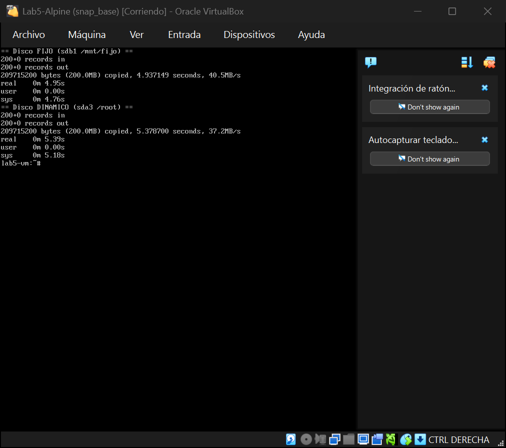

### Paso 7: Decisión Técnica — ¿qué modo de red usar en este escenario y con qué implicaciones de seguridad?

Para una VM de práctica que el estudiante corre en su propio equipo y que ningún otro dispositivo necesita alcanzar, NAT es el modo más apropiado por defecto. En NAT VirtualBox funciona como un router, la VM queda en una red privada 10.0.2.x detrás del anfitrión y solo ella puede iniciar conexiones hacia afuera, los demás equipos de la red local no ven su IP ni pueden iniciar conexiones hacia ella, así que aunque Alpine tenga sshd activo nadie de afuera llega a ese puerto si no se configura un reenvío de puertos a propósito. Host-Only sería preferible dentro del curso cuando se quiere experimentar con configuraciones de red, por ejemplo probar sshd o un servicio desde el anfitrión, sin exponer la VM a ningún tráfico externo, ni siquiera saliente. Lo que se pierde con Host-Only es el acceso a internet, no se puede usar apk update ni descargar paquetes, por eso en el Paso 4 fue necesario volver a NAT para instalar el software. Bridge es la opción de mayor riesgo porque la VM recibe una IP en la misma red local del anfitrión y queda alcanzable por cualquier dispositivo de esa red, incluidos los servicios que Alpine tenga activos como sshd en el puerto 22, lo que aumenta la superficie de ataque y la posibilidad de un acceso no autorizado.

### Paso 8: Decisión Técnica — disco fijo frente a dinámico, y asignación de CPU/RAM

Según la tabla del Paso 6 el disco fijo, con 4.95 s frente a 5.39 s del dinámico, fue el más rápido en escritura secuencial. Un disco fijo evita el costo de crecimiento porque reservó todo su tamaño en el disco del anfitrión desde que se creó, entonces cada escritura cae en espacio que ya existe, mientras que el disco dinámico tiene que hacer crecer el archivo .vdi en el sistema de archivos del anfitrión durante la escritura, pedir bloques nuevos y actualizar su tabla de asignación, y eso agrega tiempo. Aun con esa ventaja, el disco dinámico sigue siendo la opción por defecto y preferida en un curso con muchos estudiantes y equipos de capacidad limitada, porque solo ocupa en el anfitrión lo que el huésped ya escribió, y mientras Alpine no llene los 10 GB el archivo pesa mucho menos, en cambio el fijo ocupa todo su tamaño desde el principio aunque esté vacío. En cuanto a recursos, asignar 2 CPUs y 2048 MB a Alpine en un anfitrión típico de 4 a 8 CPUs y 8 a 16 GB es razonable porque Alpine consume muy poco y al anfitrión le sobra para su propio sistema. Asignar todas las CPUs o la mayoría de la RAM sería mala práctica porque el anfitrión se queda sin recursos, empieza a paginar a disco, todo se vuelve lento incluida la propia VM y las mediciones salen alteradas.

**Checkpoint 7**

La captura muestra las dos decisiones técnicas de los Pasos 7 y 8 tal como quedaron en este README.

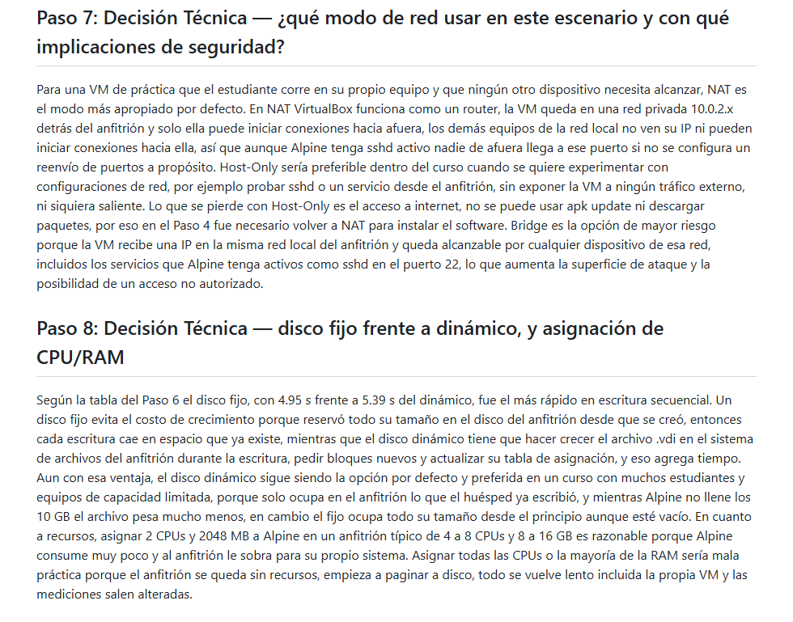

### Paso 9: Exportación en formato OVF y consolidación del repositorio

Con la VM apagada se exportó con `VBoxManage export "Lab5-Alpine" --output "Lab5-Alpine-export.ova" --manifest --options manifest`. El archivo Lab5-Alpine-export.ova quedó de 152 859 136 bytes, unos 146 MB. El .ova y el disco fijo Lab5-Alpine-fixed.vdi no se subieron al repositorio por su tamaño, el proceso queda documentado con la captura, que muestra la salida de `dir` con el .ova, los dos discos .vdi y el ISO de Alpine con sus tamaños. El repositorio consolidado con los archivos de ambas partes está publicado en https://github.com/juancamilodb6714/duran-post1-u5.

**Checkpoint 8**

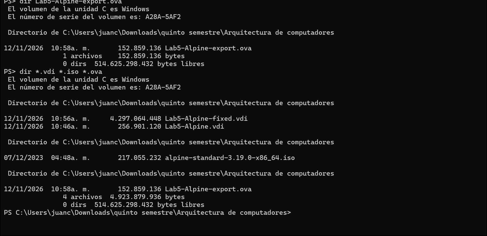

---

## Mapa de evidencias

La tabla relaciona cada checkpoint del enunciado con su captura en la carpeta capturas.

| Parte | Checkpoint | Qué muestra | Captura |
|---|---|---|---|
| 1 | 2 | DOSBox-X con el prompt C:\\ y la salida de nasm -v | [cp2_dosbox_nasm.png](capturas/cp2_dosbox_nasm.png) |
| 1 | 3 | Ensamblado y salida de saludo.com | [cp3_saludo.png](capturas/cp3_saludo.png) |
| 1 | 4 | Interacción completa de entrada.com | [cp4_entrada.png](capturas/cp4_entrada.png) |
| 1 | 5 | Sesión de DEBUG con desensamblado y pasos | [cp5_debug.png](capturas/cp5_debug.png) |
| 1 | 6 | Primera medición de ciclos.com con cycles=8000 | [cp6_ciclos.png](capturas/cp6_ciclos.png) |
| 1 | 7 | Corrida con cycles=8000 | [cp7_cycles_8000.png](capturas/cp7_cycles_8000.png) |
| 1 | 7 | Corrida con cycles=1000 | [cp7_cycles_1000.png](capturas/cp7_cycles_1000.png) |
| 1 | 7 | Corrida con cycles=20000 | [cp7_cycles_20000.png](capturas/cp7_cycles_20000.png) |
| 1 | 8 | Decisiones técnicas de cycles | [cp8_cycles_decisiones.png](capturas/cp8_cycles_decisiones.png) |
| 2 | 1 | Configuración de la VM Lab5-Alpine | [cp1_vm_config.png](capturas/cp1_vm_config.png) |
| 2 | 2 | Alpine instalado, IP por NAT y ping a 8.8.8.8 | [cp2_alpine_instalado.png](capturas/cp2_alpine_instalado.png) |
| 2 | 3 | Modo NAT | [cp3_red_nat.png](capturas/cp3_red_nat.png) |
| 2 | 3 | Modo Host-Only visto desde la VM | [cp3_red_hostonly virtualBox.png](capturas/cp3_red_hostonly%20virtualBox.png) |
| 2 | 3 | Modo Host-Only, ping desde el anfitrión | [cp3_red_hostonly.png](capturas/cp3_red_hostonly.png) |
| 2 | 3 | Modo Bridge | [cp3_red_bridge.png](capturas/cp3_red_bridge.png) |
| 2 | 4 | Lista de snapshots | [cp4_snapshots.png](capturas/cp4_snapshots.png) |
| 2 | 4 | Estado tras restaurar snap_base | [cp4_restauracion.png](capturas/cp4_restauracion.png) |
| 2 | 5 | nproc y free -m con 2 CPUs y 2048 MB | [cp5_recursos.png](capturas/cp5_recursos.png) |
| 2 | 6 | Benchmark de disco fijo frente a dinámico | [cp6_disco.png](capturas/cp6_disco.png) |
| 2 | 7 | Decisiones técnicas de red y almacenamiento | [cp7_decisiones_red_disco.png](capturas/cp7_decisiones_red_disco.png) |
| 2 | 8 | Exportación OVA con su tamaño | [cp8_recursos_disco.png](capturas/cp8_recursos_disco.png) |

## Conclusiones

En DOSBox-X todo el procesador y el entorno DOS se recrean por software, cada instrucción de 16 bits se interpreta, y por eso la velocidad se controla con cycles, el mismo ciclos.com tardó desde unos segundos hasta varios minutos cambiando solo ese valor. En VirtualBox el código del huésped se ejecuta casi directamente en la CPU real con ayuda de la virtualización por hardware, entonces no hay un valor como cycles y lo que se configura es cuánta CPU, RAM y disco se le asigna a la VM. Se comprobó que cycles es una velocidad de emulación medida en instrucciones emuladas y no tiene relación directa con los ciclos de reloj del anfitrión. En los modos de red se vio que NAT es el más seguro para una VM personal, Host-Only sirve para aislarla por completo y Bridge la expone a toda la red local. Los snapshots permitieron volver al estado base sin desinstalar nada a mano, la reasignación con modifyvm se reflejó de inmediato en nproc y free, y la prueba de discos mostró la diferencia entre reservar todo el espacio desde el inicio o hacerlo crecer a medida que se escribe.

## Referencias

DOSBox-X Team. (2026). *DOSBox-X 2026.08.31* [Software]. https://dosbox-x.com

Oracle. (2024). *Oracle VM VirtualBox user manual*. https://www.virtualbox.org/manual/

Alpine Linux Development Team. (2023). *Alpine Linux 3.19* [Software]. https://alpinelinux.org

The NASM Development Team. (2023). *NASM: The Netwide Assembler*. https://www.nasm.us/docs.php
